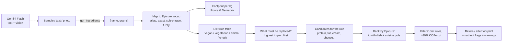

# Recipe Remix (working title)

**Same dish, lighter footprint, still itself.**

Paste a recipe (or photograph it), pick a diet mode, and get a lower-carbon version that stays inside the dish's cuisine, with a before/after footprint and nutrition warnings.

Most "go plant-based" tools say "swap beef for tofu" no matter what you're cooking. Recipe Remix uses **Epicure**, an open ingredient-embedding model trained on about 4.14 million recipes, to rank plant swaps by how well they fit *this* dish and *its* cuisine:

| Dish | Replaces | Top-ranked swap | CO2e change (vegan mode) |
|---|---|---|---|
| Butter chicken | chicken | chana dal / chickpea | −62% |
| Beef tacos | ground beef, cheddar | pinto bean / black bean | −96% |
| Spaghetti bolognese | ground beef | lentil / chickpea | −94% |
| Mapo tofu with pork | pork | tofu / edamame | −54% |

Built solo at **Girls Hoo Hack 2026** (UVA, Oct 17–18).
Tracks: Most Sustainable · Best Beginner · Best AI/ML · MLH Best Use of Gemini API

---

## Quick start

```bash
python3 -m venv .venv && source .venv/bin/activate
pip install -r requirements.txt
python scripts/download_models.py          # Epicure embeddings (~13 MB)
cp .env.example .env                       # then paste your Gemini key (aistudio.google.com)

.venv/bin/uvicorn server:app --reload       # web app at http://localhost:8000
python cli.py --sample butter_chicken --mode vegan    # command line, no API key needed
python cli.py --text "1 lb ground beef, 8 corn tortillas, 1 onion, ..." --mode vegetarian
python cli.py --photo my_recipe.jpg --mode vegan
pytest -q                                   # diet-rule tests
```

Samples: `butter_chicken`, `beef_tacos`, `bolognese`, `mapo_tofu`. Modes: `flexitarian` (replace beef and lamb only), `vegetarian`, `vegan`. Models: `--model core|cooc|chem`.

## How it works



**Rule: embeddings propose, rules decide.**

1. **Input.** Every input type goes through one function, `get_ingredients()`, which returns `[{name, grams}]`. Gemini Flash reads pasted text or a photo of a recipe in one call (JSON output), and every result is cached on disk.
2. **Map** each name to Epicure's 1,790-ingredient vocabulary. Anything we can't match is reported, not guessed.
3. **Footprint.** Each ingredient is linked to one of 37 food categories from Poore & Nemecek (2018), and its weight is multiplied by that category's CO2e, land and water per kg. If we use the closest category instead of an exact match, the output marks it as a proxy. The output also shows **coverage**: the share of the recipe's weight we have data for.
4. **Diet rules.** A hand-built rule table (`remix/catalog.py`) is the only thing that decides what fits a diet. It knows about hidden animal ingredients (parmesan uses animal rennet, Worcestershire sauce contains anchovy, gelatin, lard, fish sauce). Anything processed or unclassified **fails closed** with "check label".
5. **Swap ranking.** We don't use raw nearest neighbors, because Epicure's nearest neighbor to chicken is pork (they appear in the same recipes). Instead, each role has a fixed list of plant-based replacements. We rank them by cosine similarity to (a) the average of the dish's *remaining* ingredients and (b) Epicure's cuisine direction for the cuisine it detects (one of seven). Swaps must cut CO2e per kg by at least 30%, so, for example, paneer never replaces chicken, because cheese has a higher footprint.
6. **Nutrition.** Each removed role flags the nutrients it supplied (B12, iron, zinc, calcium, omega-3, iodine, choline) with a tip. This is not medical advice.

## How accurate is it?

We hand-labelled 31 meat dishes across 7 cuisines with the plant protein their well-known plant-based version uses (chana masala for chicken curry, bean tacos, jackfruit pulled pork, tofu kung pao…). The labels were written **before** running any method. Then we checked how often each method's first pick matches (`python eval/benchmark.py`, Epicure-Core, vegan mode, same diet and footprint filters for every method):

| Method | Hit@1 | Hit@3 |
|---|---|---|
| **Recipe Remix** (dish context + cuisine lock) | **81%** | 90% |
| Recipe Remix without cuisine lock | 74% | 94% |
| Closest plant protein to the meat itself | 48% | 68% |
| "Just use tofu" | 32% | 81% |
| Random | 15% | 40% |

Misses: beef burger (picked kidney bean, not black bean), pulled pork (beans, not jackfruit), goulash (chickpea, not mushroom); lasagna, moussaka and meatballs had the traditional swap at #2–3. Small test set with our own labels: a sanity check, not a published benchmark. The Cooc model without cuisine lock scored 84% hit@1; we kept Core + lock as the default because we chose it before seeing results.

## Flavor map

`scripts/build_flavor_map.py` projects all 1,790 Epicure-Core embeddings to 2D with t-SNE (cosine). The app draws your dish on it, animates each swap, and highlights the three dish ingredients closest to the replacement (cosine in the full 300-d space) as the "why". t-SNE distorts long distances, so the map is for intuition; scoring never uses it.

## Limits

- Footprints are **global averages** (570 studies, median year 2010), farm to retail. Your local beef or tofu may differ a lot.
- Butter, cream, cooking oils and spices aren't in the dataset, so they show as unknown (see "coverage").
- Swaps are **plausible**, based on ingredient co-occurrence and flavor-compound structure. They haven't been taste-tested and aren't guaranteed authentic.
- Swaps are 1:1 by weight, which is a simplification.
- Beef uses the "beef herd" figure (99 kg CO2e/kg). Beef from dairy herds is lower (33 kg), so beef-heavy savings are an upper estimate.
- Some swaps cut CO2e but use more land or water (cashews need a lot of water). The output shows all three numbers, so you can see the trade-off.

## What's next

- Deploy the web app to a public URL with our GoDaddy domain
- Fill footprint gaps (butter, cream, oils) with k-NN imputation over Epicure embeddings, tested against held-out ingredients
- "How far" slider, allergen warnings, and the Core / Cooc / Chem model dial in the UI

## What I learned

_(to fill in: embeddings, cosine similarity, prompt-to-JSON with Gemini, life-cycle footprint data, …)_

## Attribution

- **Epicure** ingredient embeddings: Radzikowski, J. and Chen, J. (2026), *Epicure: Navigating the Emergent Geometry of Food Ingredient Embeddings*, arXiv:2605.22391. KAIKAKU.AI. CC-BY-4.0. Used unmodified, loaded from the published safetensors files.
- **Footprint data:** Poore, J. and Nemecek, T. (2018), *Reducing food's environmental impacts through producers and consumers*, Science 360:987–992, via Our World in Data (CC-BY-4.0).
- **Gemini API** (Google) for recipe text and photo parsing.
- The flavor-graph view is styled after the Epicure team's own explorer at [epicure.kaikaku.ai](https://epicure.kaikaku.ai/).
